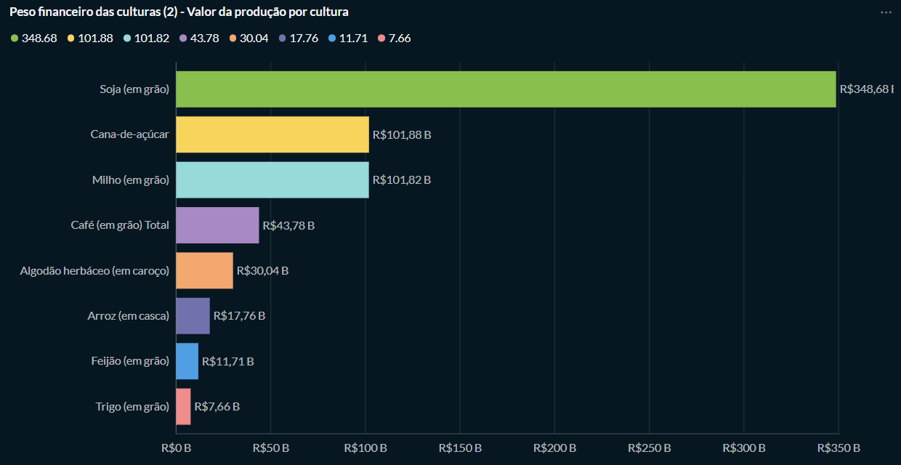
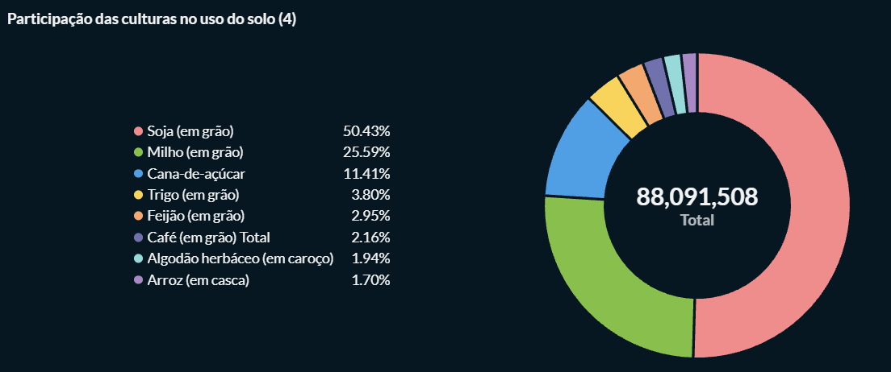
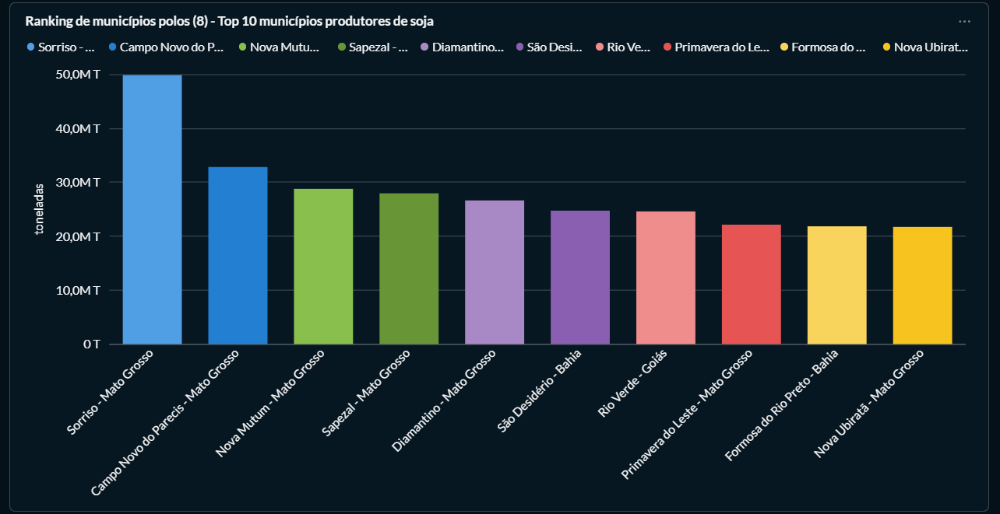

# Trabalho II — Dashboard de Análise da Produção Agrícola do RS

**Disciplina:** Banco de Dados 2 (IBI-BDD002)  
**Curso:** Ciência da Computação — Bacharelado  
**Campus:** IFRS Ibirubá  
**Grupo:** Metabase — Mateus, Kerlon e Michel  
**Docente:** Edimar Manica  
**Ferramenta:** Metabase (open source, licença AGPL v3)  
**Base de dados:** Produção Agrícola Municipal (PAM) — IBGE/SIDRA  
**Data de entrega:** 27/11/2026  

---

## 1. Público-Alvo

O dashboard é direcionado principalmente a **gestores públicos municipais e
órgãos de assistência técnica rural** (Secretaria da Agricultura,
Emater/RS-Ascar), que podem utilizar essas informações para:

- Direcionar políticas públicas e programas de assistência técnica para regiões
  com queda de produtividade
- Planejar ações de resposta a eventos climáticos adversos (seca, geadas)
- Subsidiar decisões sobre investimento em infraestrutura rural (armazenagem,
  irrigação, logística) com base nos municípios de maior relevância produtiva
- Acompanhar a evolução da produção agrícola do estado ano a ano, com dados
  oficiais e comparáveis

Secundariamente, as informações também são úteis para **cooperativas agrícolas,
instituições financeiras de crédito rural e o próprio produtor**, para decisões
de plantio, avaliação de risco de safra e planejamento de investimento.

---

## 2. Objetivo Geral do Dashboard

Analisar a evolução da produção agrícola dos municípios brasileiros, com
destaque para o Rio Grande do Sul, observando área plantada, produtividade,
quantidade produzida e valor da produção ao longo da série histórica
disponível na base (2013–2023) do IBGE/SIDRA. O dashboard permite filtrar por
cultura, ano e estado, busca evidenciar tendências, identificar municípios de
destaque produtivo e quantificar o impacto de eventos climáticos (como a
estiagem de 2022) na produtividade das lavouras, fornecendo subsídio concreto
para tomada de decisão em políticas de assistência técnica rural.

---

## 3. Ferramenta Utilizada

**Metabase** — plataforma open source de Business Intelligence licenciada sob
AGPL v3, utilizada para consulta, visualização e publicação de dashboards
interativos a partir dos dados armazenados no PostgreSQL.

---

## 4. Visualizações do Dashboard

Além dos 10 gráficos abaixo, o dashboard traz 5 indicadores (KPIs): valor
total da produção, rendimento médio, área plantada, quantidade produzida e
contagem de municípios. Os filtros disponíveis são cultura, ano e estado.

> **Nota:** o campo **Como** (print com dados reais) será preenchido conforme
> cada gráfico for finalizado no Metabase. O campo **SQL (registro)** guarda a
> consulta usada, para que outras pessoas possam reproduzir o gráfico em suas
> próprias bases.

---

### Gráfico 1 — Eficiência agrícola por estado

**O quê:** rendimento médio (kg/ha, calculado como quantidade produzida ÷ área
plantada) de cada unidade da federação, para a cultura selecionada no filtro.  
**Como:** mapa do Brasil, com os estados coloridos por faixa de rendimento.

<!--  -->
[inserir print aqui]

**Por quê:** mostra rapidamente quais estados são mais e menos produtivos e
onde o RS se posiciona, indicando onde a assistência técnica pode ter mais
efeito.

**SQL (registro):**

```sql
-- preencher após validar no banco
```

---

### Gráfico 2 — Peso financeiro das culturas

**O quê:** valor total da produção de cada cultura.  
**Como:** gráfico de colunas verticais, uma coluna por cultura, ordenadas da
maior para a menor.

<!--  -->
[inserir print aqui]

**Por quê:** cria um ranking econômico das culturas e mostra onde está o maior
retorno financeiro, ajudando a priorizar apoio e políticas.

**SQL (registro):**

```sql
-- preencher após validar no banco
```

---

### Gráfico 3 — Evolução histórica da produção

**O quê:** quantidade produzida (ou valor da produção) por ano, de 2013 a 2023,
para a cultura e o estado selecionados.  
**Como:** gráfico de linhas (série temporal), com os anos no eixo X.

<!--  -->
[inserir print aqui]

**Por quê:** evidencia tendências de crescimento, estagnação e quebras de safra
por seca ou geada (como a estiagem de 2022 no RS), apoiando planejamento e
resposta a eventos climáticos.

**SQL (registro):**

```sql
-- preencher após validar no banco
```

---

### Gráfico 4 — Participação das culturas no uso do solo

**O quê:** percentual da área plantada de cada cultura em relação ao total, no
ano selecionado.  
**Como:** gráfico de rosca (donut).

<!--  -->
[inserir print aqui]

**Por quê:** mostra quais culturas ocupam mais espaço no território e o quanto
a produção depende de poucas culturas. O gestor pode avaliar essa dependência e
decidir entre incentivar a diversificação ou reforçar o apoio às culturas
dominantes.

**SQL (registro):**

```sql
-- preencher após validar no banco
```

---

### Gráfico 5 — Relação entre área plantada e eficiência

**O quê:** área plantada (eixo X) cruzada com o rendimento médio em kg/ha (eixo
Y) para cada estado produtor.  
**Como:** gráfico de dispersão (scatter), com um ponto por estado.

<!--  -->
[inserir print aqui]

**Por quê:** mostra que o maior estado não é necessariamente o mais produtivo,
identificando estados que produzem muito em pouca área e estados com grandes
áreas e baixa eficiência. A assistência técnica pode priorizar estados com
muita área e baixa eficiência e usar os mais eficientes como referência de boas
práticas.

**SQL (registro):**

```sql
-- preencher após validar no banco
```

---

### Gráfico 6 — Evolução comparativa de culturas

**O quê:** valor da produção das principais culturas ao longo dos anos.  
**Como:** gráfico de área empilhada.

<!--  -->
[inserir print aqui]

**Por quê:** mostra o crescimento histórico do setor e como a proporção de cada
cultura muda com o tempo, por exemplo se a soja está ocupando o espaço que era
de outro produto. O gestor pode antecipar mudanças no perfil produtivo, como o
avanço da soja, e adaptar capacitação e crédito às culturas que crescem.

**SQL (registro):**

```sql
-- preencher após validar no banco
```

---

### Gráfico 7 — Matriz de crescimento regional

**O quê:** valor total da produção, com os estados nas linhas e os anos nas
colunas.  
**Como:** tabela dinâmica (pivot table).

<!--  -->
[inserir print aqui]

**Por quê:** permite ler os dados em formato de matriz e identificar
rapidamente quais estados estão estagnados e quais estão em expansão ano após
ano. O gestor pode identificar estados e anos de queda e direcionar apoio às
regiões estagnadas, usando os números exatos em relatórios.

**SQL (registro):**

```sql
-- preencher após validar no banco
```

---

### Gráfico 8 — Ranking de municípios polos

**O quê:** os 10 municípios com maior quantidade produzida (toneladas) da
cultura selecionada, para o ano e o estado escolhidos nos filtros (padrão:
soja, 2023, todos os estados).  
**Como:** gráfico de barras horizontais, com uma cor para cada município.

<!--  -->


**Por quê:** desce da visão por estado para os municípios que realmente movem a
produção, e permite ao gestor municipal comparar seu município com os líderes.

**SQL (registro):**

Versão usada no Metabase (com as variáveis de filtro `cultura`, `ano` e
`estado`; `cultura` e `estado` são Field Filters, `ano` é do tipo Number):

```sql
SELECT
  m.nome || ' - ' || e.nome AS municipio,
  m.nome || ' - ' || e.nome AS legenda,
  SUM(pa.valor) AS toneladas
FROM producao_agricola pa
JOIN municipio m ON pa.municipio_id = m.id
JOIN estado    e ON m.estado_id     = e.id
JOIN produto   p ON pa.produto_id   = p.id
JOIN variavel  v ON pa.variavel_id  = v.id
WHERE v.nome = 'Quantidade produzida (Toneladas)'
  AND {{cultura}}
  AND pa.ano = {{ano}}
  [[AND {{estado}}]]
GROUP BY m.id, m.nome, e.nome
ORDER BY toneladas DESC
LIMIT 10;
```

Versão para rodar direto no PostgreSQL (sem variáveis do Metabase; troque a
cultura, o ano e, se quiser, descomente o filtro de estado):

```sql
SELECT
  m.nome || ' - ' || e.nome AS municipio,
  SUM(pa.valor) AS toneladas
FROM producao_agricola pa
JOIN municipio m ON pa.municipio_id = m.id
JOIN estado    e ON m.estado_id     = e.id
JOIN produto   p ON pa.produto_id   = p.id
JOIN variavel  v ON pa.variavel_id  = v.id
WHERE v.nome = 'Quantidade produzida (Toneladas)'
  AND p.nome ILIKE 'Soja%'
  AND pa.ano = 2023
  -- AND e.nome = 'Rio Grande do Sul'
GROUP BY m.id, m.nome, e.nome
ORDER BY toneladas DESC
LIMIT 10;
```

---

### Gráfico 9 — Relação histórica entre volume produzido e área plantada

**O quê:** quantidade produzida (toneladas) e área plantada ao longo dos anos,
para o produto filtrado.  
**Como:** gráfico combinado, com barras para a quantidade produzida e linha
para a área plantada.

<!--  -->
[inserir print aqui]

**Por quê:** mostra como a produção cresceu. Se as barras sobem e a linha de
área fica estável, houve ganho de produtividade. Se ambas sobem juntas, o
crescimento veio da expansão da área plantada. O gestor pode usar essa leitura
para decidir se o apoio deve focar em ganho de produtividade ou em ampliação de
área.

**SQL (registro):**

```sql
-- preencher após validar no banco
```

---

### Gráfico 10 — Concentração de riqueza agrícola

**O quê:** participação de cada estado no valor total da produção nacional.  
**Como:** mapa de árvore (treemap), com retângulos proporcionais ao valor.

<!--  -->
[inserir print aqui]

**Por quê:** é mais legível que uma pizza quando há 27 estados e mostra
rapidamente a dominância econômica de alguns estados e o peso relativo do RS.
Permite dimensionar o peso econômico de cada estado e do RS no país, apoiando
pedidos de recursos e políticas para o setor.

**SQL (registro):**

```sql
-- preencher após validar no banco
```

---

## 5. Potencialidades da Ferramenta

1. **Gratuito e open source** — zero custo de licenciamento; a versão
   Community Edition oferece todas as funcionalidades essenciais de BI sem
   exigir contrato ou pagamento de assinatura.

2. **Interface visual sem SQL para consultas básicas** — usuários sem
   conhecimento de banco de dados conseguem montar perguntas, filtros e
   agrupamentos arrastando campos pela interface, sem escrever uma linha de
   código.

3. **Joins visuais entre tabelas relacionais** — o editor de modelo de dados
   permite definir relacionamentos entre tabelas (chaves estrangeiras) de forma
   gráfica, e o Metabase os traduz automaticamente em JOINs nas consultas
   geradas, dispensando SQL manual para navegação entre dimensões.

4. **Variedade de tipos de visualização no mesmo motor de dados** — a mesma
   consulta pode ser apresentada como tabela, gráfico de barras, linha, pizza,
   funil ou mapa coroplético sem alterar a query, facilitando a escolha do
   visual mais adequado a cada público.

5. **Self-hosted via Docker — controle total sobre hospedagem dos dados** — é
   possível rodar o Metabase inteiramente na infraestrutura própria, sem
   enviar dados a servidores de terceiros, atendendo requisitos de privacidade
   e LGPD em projetos com dados sensíveis.

---

## 6. Fragilidades da Ferramenta

1. **Sincronização de schema não é automática nem confiável** — após adicionar
   ou alterar tabelas no PostgreSQL, o Metabase pode apresentar as tabelas
   "sem campos" até que uma sincronização manual seja forçada pelo
   administrador, causando confusão e interrompendo o fluxo de trabalho.

2. **Mensagens de erro pouco informativas** — erros de tipagem em joins (ex.:
   *"operador não existe: integer = character varying"*) são exibidos sem
   indicar qual relacionamento está incorreto, dificultando o diagnóstico sem
   recorrer aos logs do banco diretamente.

3. **Funcionalidades avançadas de colaboração e auditoria reservadas à versão
   paga** — controle granular de permissões por linha, auditoria de acessos,
   SSO e suporte oficial estão disponíveis apenas nas edições Pro/Enterprise,
   criando limitações relevantes para uso em ambientes institucionais.

4. **Performance degradada em consultas com múltiplos joins sobre tabelas
   grandes** — a base utilizada contém aproximadamente 2,9 milhões de linhas;
   dashboards com cadeias de joins encadeados (município → estado → região)
   apresentaram lentidão perceptível, exigindo criação de índices adicionais e
   ajuste de configurações do PostgreSQL fora do Metabase.

5. **Curva de aprendizado para modelagem relacional** — embora a interface
   visual abstrai o SQL, o usuário ainda precisa compreender o conceito de
   chaves estrangeiras e cadeias de relacionamento para configurar o modelo de
   dados corretamente. Erros na definição dos relacionamentos no Metabase
   resultam em resultados silenciosamente incorretos nos gráficos, sem aviso
   explícito.